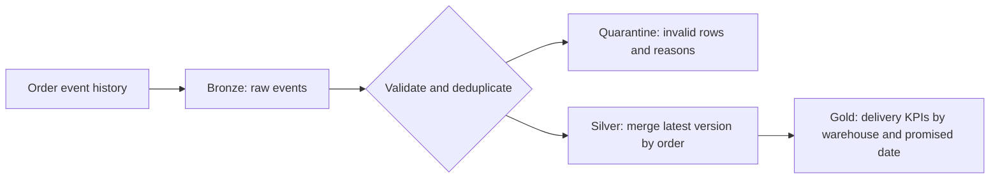

# Fulfillment Lakehouse

[](https://github.com/manoanasani8/fulfillment-lakehouse/actions/workflows/tests.yml)

A portfolio project by **Mano Anasani**. It turns synthetic order events into delivery performance metrics using PySpark, Spark SQL, and Delta Lake. The design reflects the lakehouse, incremental processing, and BI work in my résumé. All data is synthetic.

## How it works



Bronze and quarantine are snapshots of the supplied event history. Silver keeps one current record per order and applies a Delta `MERGE` only when the incoming version is higher. Identical replays do not add duplicate rows. Conflicting valid payloads for the same order and version stop the run before Silver is written. Gold recomputes metrics from current Silver state using Spark SQL. The on-time percentage divides on-time deliveries by delivered orders; it is blank if no orders have been delivered.

## Example

The first fixture has seven raw rows, including an exact replay, an out-of-order update, and one impossible date. Silver retains three orders; the invalid row goes to quarantine. The second fixture adds a late older version and a newer correction.

| Warehouse | After initial load | After applying the correction |
| --- | --- | --- |
| CHI | 1 of 2 delivered orders on time (50%) | 2 of 2 on time (100%) |
| PHL | 1 cancelled order, no delivery rate | Unchanged |

The integration test checks those results, the quarantine reason, and the retained versions in Silver.

## Run locally

### Run the container

The [GitHub container package](https://github.com/users/manoanasani8/packages/container/package/fulfillment-lakehouse) runs the bundled synthetic demo and prints the warehouse delivery metrics. Docker is required. If the package is private, sign in to GitHub Container Registry with a token that can read it. The first Spark run downloads the Delta JARs from Maven Central.

```sh
docker run --rm ghcr.io/manoanasani8/fulfillment-lakehouse:latest
```

To keep the generated Delta tables after the container exits, mount a named volume:

```sh
docker run --rm -v fulfillment-demo:/app/artifacts ghcr.io/manoanasani8/fulfillment-lakehouse:latest
```

### Run with Python

Use Python 3.12 and Java 17 on Linux, macOS, or Windows Subsystem for Linux. The first run needs access to Maven Central for the Delta JARs. No cloud account or credentials are required. See the [Delta Lake quickstart](https://docs.delta.io/quick-start/) and [Spark compatibility matrix](https://docs.delta.io/releases/).

```sh
python -m pip install -r requirements.txt
python lakehouse.py
python -m unittest -v
```

To replay the correction against the same output directory:

```sh
cat examples/orders.jsonl examples/late-updates.jsonl > history.jsonl
python lakehouse.py --input history.jsonl --output artifacts
```

The four Delta tables are written under `artifacts/`. Keep the full event history for Bronze and quarantine and use a fresh output directory for unrelated datasets. The pipeline is a single-writer batch demo. It does not deploy Databricks, run a Kafka stream, or provide an atomic commit across all four tables.
